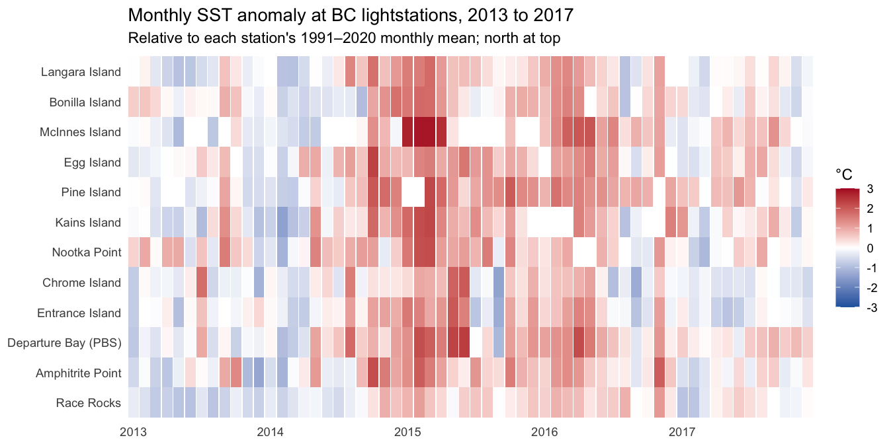

# BC lightstation SST: QARTOD-style quality control in R

<!-- After the Zenodo release, paste the DOI badge here -->

Daily sea surface temperature (SST) from British Columbia lightstations, pulled from the [CIOOS Pacific ERDDAP](https://data.cioospacific.ca/erddap/tabledap/BCSOP_daily.html) server, annotated with automated quality control flags adapted from the IOOS [QARTOD](https://ioos.noaa.gov/project/qartod/) manuals, and published as a CF/ACDD-compliant NetCDF file, a tidy CSV, and a data dictionary.

Project site: https://emmabranch.github.io/bc-lightstation-qc/

Companion project: [BC Salmon Explorer](https://emmabranch.shinyapps.io/bc-salmon-explorer) ([repo](https://github.com/emmabranch/bc-salmon-explorer)), which shows salmon data for the same coast and years.



This is a personal project: I'm an epidemiologist and data analyst, new to oceanographic data, working through an open CIOOS dataset using the ocean observing community's own standards for quality control and metadata.

## What this project does

- Retrieves BCSOP daily lightstation data from 1991 onward with `rerddap`, logging the exact request.
- Keeps stations with at least 80% daily coverage over the 1991 to 2020 climate normal period.
- Applies four QARTOD tests (gross range, spike, rate of change, flat line) plus an aggregate flag, using the standard flag scheme: 1 PASS, 2 NOT_EVALUATED, 3 SUSPECT, 4 FAIL, 9 MISSING.
- Never alters source values. Flags sit alongside the data, linked in the NetCDF with `ancillary_variables` and CF quality-flag standard names.
- Writes CF-1.8 and ACDD-1.3 metadata, checked with the IOOS Compliance Checker (report in `docs/`).
- Maps monthly SST anomalies across the 2014 to 2016 northeast Pacific marine heatwave: an animated map, a station-by-month heatmap, and an interactive map with year buttons and per-station popups.

## Important limitations

- QARTOD tests were designed mainly for real-time, high-frequency sensor data. These are daily bucket samples taken near daytime high tide, so thresholds were adapted and are documented below.
- Daily values contain a 14-day tidal-cycle sampling artifact (noted by the data provider). This affects the spike and rate of change tests.
- This is an independent portfolio product, not an official DFO or CIOOS dataset. For authoritative data, use the source.

## QC decisions

| Test | Setting | Rationale | Changed after review? |
|---|---|---|---|
| Gross range | FAIL outside -2.5 to 35 degC. SUSPECT outside 0 to 22 degC (outer coast) or 0 to 26 degC (Chrome Island, Departure Bay, Entrance Island) | Values above 22 degC at the three Strait of Georgia stations occurred on the same dates across several stations in warm summers, so they are likely real | Yes: added station-specific limits (47 SUSPECT reduced to 0) |
| Spike | SUSPECT > 2.5 degC, FAIL > 5 degC from neighbour mean. A FAIL is downgraded to SUSPECT if a neighbour has a larger spike | A single bad value (8.1 between 18.8 and 17.8, Departure Bay, July 2024) caused its good neighbour to FAIL as well | Yes: added neighbour adjustment with a unit test (4 FAIL reduced to 3) |
| Rate of change | SUSPECT if day-to-day change > 3 SD of previous 30 days (min 10 obs) | Suspects spread evenly across stations and months, about 0.7% of values | No |
| Flat line | SUSPECT at 5, FAIL at 10 identical consecutive daily values | Longest run: 8.5 degC for about 19 days at Race Rocks (Feb 2010). Some runs reflect whole-degree recording (see Known issues) | No |

A Nootka Point value of 4.6 degC on 30 March 2022 (spike FAIL) was cross-checked against salinity, which rose rather than fell, so a cold freshwater event is unlikely and the FAIL was kept.

## Known issues

- **Recording precision varies.** Values are normally recorded to 0.1 degC, but in some station-years 30% to 65% of values are whole numbers (Egg Island 2004 to 2005, Chrome Island 2008 to 2011, Race Rocks 2009, Nootka Point 1994 to 1995). This suggests periods of whole-degree recording. Values were not altered.
- **Station IDs are kept as in the source**, including `mcinees_island_lightstation` (likely McInnes Island).
- **Compliance:** the NetCDF passes the IOOS Compliance Checker for CF-1.8 with no issues. For ACDD-1.3, the only remaining items are four optional vertical attributes (`geospatial_vertical_min`, `_max`, `_positive`, `geospatial_bounds_vertical_crs`), omitted because the data are surface samples with no depth variable. Full report: `docs/compliance_report.txt`.

## Outputs (`data/output/`)

| File | Contents |
|---|---|
| `bc_lightstation_sst_qc.nc` | NetCDF, CF timeSeries (orthogonal station x time), SST plus five flag variables |
| `bc_lightstation_sst_qc.csv` | Same data in long format, one row per station-day |
| `data_dictionary.csv` | Variable definitions, units, CF standard names, allowed values |
| `monthly_sst_anomalies_2013_2017.csv` | Monthly anomalies used in the map |

## Reproduce

```bash
Rscript tests/test_qartod.R
Rscript R/01_download.R
Rscript R/02_qc.R
Rscript R/03_write_outputs.R
Rscript R/04_map.R
compliance-checker --test=cf:1.8 --test=acdd:1.3 data/output/bc_lightstation_sst_qc.nc
quarto render
```

## Data source and licence

Source: British Columbia Shore Station Oceanographic Program (BCSOP), Institute of Ocean Sciences, Fisheries and Oceans Canada, distributed by CIOOS Pacific. Contains information licensed under the [Open Government Licence - Canada](https://open.canada.ca/en/open-government-licence-canada).

Code: MIT licence. Derived data: CC-BY-4.0, with attribution to the source above.
