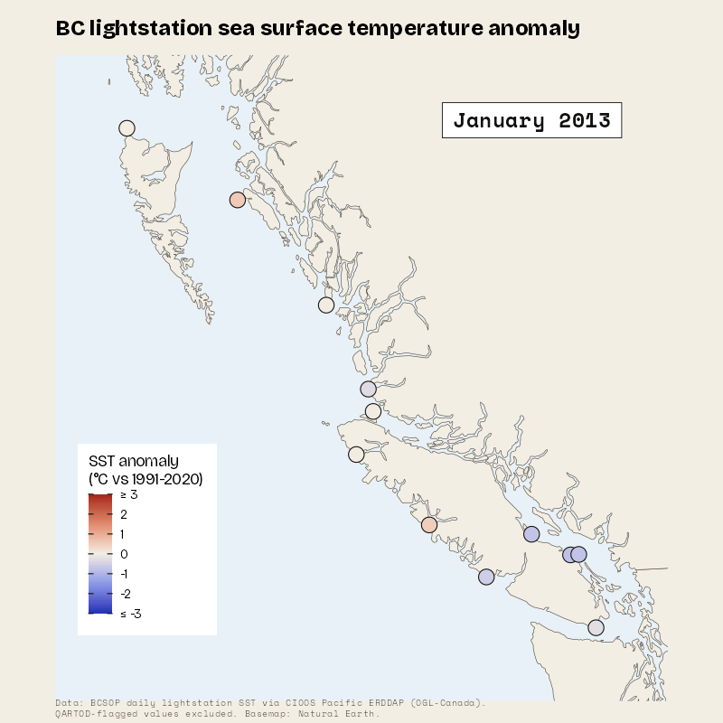
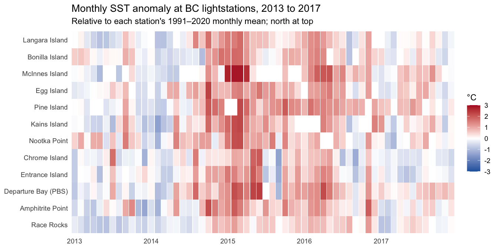

An **anomaly** is the difference from a station's 1991 to 2020 average for that calendar month. Removing the seasonal cycle this way makes unusual warmth stand out. Only PASS and NOT_EVALUATED values are used.

## Explore by year

Choose a year at the top right to see each station's annual mean anomaly. Click or tap a station for its monthly record, with 2014 to 2016 shaded.

```{r}
#| label: interactive-map
source("R/05_interactive_map.R")
build_interactive_map()
```

## Month by month



## All stations at a glance



At nearly every station, 2013 and early 2014 were close to normal, with a cool spell in early 2014. From around autumn 2014, warm anomalies appeared almost everywhere at once. They were strongest in the winter of 2014 to 2015, reaching about +3 °C at McInnes Island, and persisted through 2015 and into 2016, with another strong warm spell in spring 2016. Most stations were back near normal by late 2016.

The three Strait of Georgia stations (Chrome Island, Entrance Island, and Departure Bay) warmed as well, but more patchily, with some near-normal or cool months in mid-to-late 2015. That's a pattern I'd want to look into further rather than explain from this figure alone.

White cells are months with fewer than 15 valid daily values, which I excluded rather than average from too few samples.

## Why it matters for salmon

The lightstation record shows ocean conditions only, but those conditions matter for salmon. DFO's review of 2015 described the Northeast Pacific warm anomaly at its peak that summer and reported on its effects on marine ecosystems and fish, including Pacific salmon (Chandler, King, and Perry, 2016). The timing in my heatmap, with coastal stations turning warm from autumn 2014, is consistent with Bond et al. (2015), who describe the offshore anomaly reaching coastal waters during 2014.

My [BC Salmon Explorer](https://emmabranch.shinyapps.io/bc-salmon-explorer) app shows salmon data for this same coast. This project does not test any link between ocean temperature and salmon; it provides quality-controlled temperature data that could support that kind of analysis.

## References

- Bond, N. A., Cronin, M. F., Freeland, H., and Mantua, N. (2015). Causes and impacts of the 2014 warm anomaly in the NE Pacific. *Geophysical Research Letters*, 42(9), 3414–3420. <https://doi.org/10.1002/2015GL063306>
- Chandler, P. C., King, S. A., and Perry, R. I. (Eds.) (2016). State of the physical, biological and selected fishery resources of Pacific Canadian marine ecosystems in 2015. *Canadian Technical Report of Fisheries and Aquatic Sciences* 3179. <https://waves-vagues.dfo-mpo.gc.ca/Library/365564.pdf>
