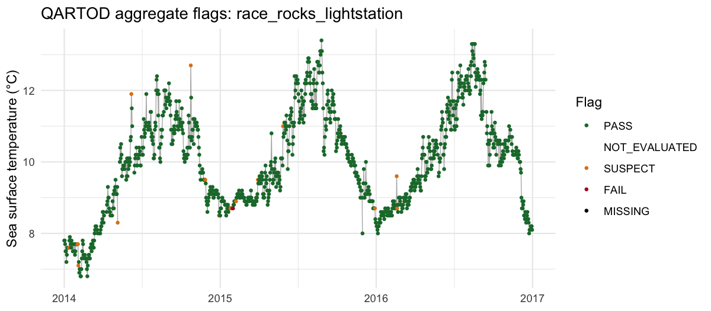
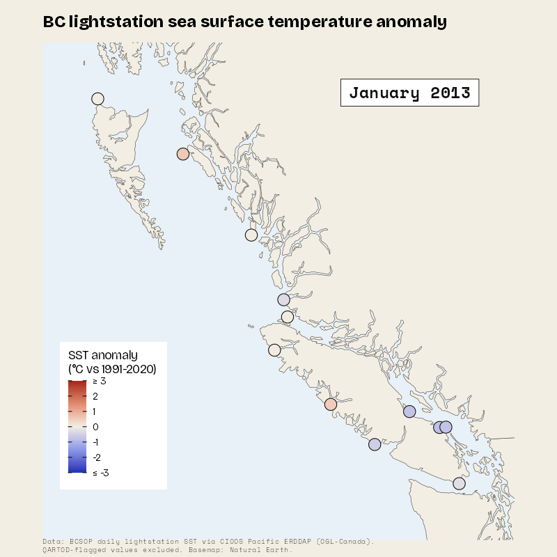

::: {.callout-note appearance="simple"}
This is a personal project. I'm an epidemiologist and data analyst, and new to oceanographic data. This page records what I did, why I made each choice, and what I learned. I'd welcome corrections from people who know this data better than I do.
:::

## Why I did this

Much of my work in health research has been the part that rarely gets seen: cleaning, documenting, and governing data so that other people can trust it and reuse it. I wanted to see how the ocean observing community handles the same problems, so I took an open dataset from CIOOS Pacific and worked through it using the community's own standards for quality control and metadata.

The project has four parts:

- **Quality control** using tests from the IOOS QARTOD manuals
- **Documentation** as a CF and ACDD compliant NetCDF file, a CSV, and a data dictionary
- **Analysis** of the 2014 to 2016 northeast Pacific marine heatwave, as seen at BC lightstations
- **A reproducible workflow** in R, archived with a DOI

## The data

The British Columbia Shore Station Oceanographic Program (BCSOP) has collected daily sea surface temperature and salinity at BC lightstations since 1914. Samples are taken by bucket, near daytime high tide, using the same method for decades so the record stays consistent. CIOOS Pacific serves the data through **ERDDAP**, a data server where every request is a URL.

I retrieved daily temperature from 1991 onward with the `rerddap` package and logged the exact request.

```{r}
#| eval: false
library(rerddap)
info_obj <- info("BCSOP_daily", url = "https://data.cioospacific.ca/erddap/")
raw <- tabledap(info_obj,
                fields = c("profile", "latitude", "longitude", "time", "TEMPTC01"),
                "time>=1991-01-01",
                url = "https://data.cioospacific.ca/erddap/")
```

I kept the 12 stations with at least 80% daily coverage over 1991 to 2020, the current climate normal period. That matches the number of stations the program says are currently active. Five stations with shorter records were excluded.

## Quality control

### The QARTOD flag scheme

QARTOD (Quality Assurance of Real-Time Oceanographic Data) is a set of IOOS manuals that describe standard tests and a shared flag scheme:

| Flag | Meaning |
|---|---|
| 1 | PASS |
| 2 | NOT_EVALUATED |
| 3 | SUSPECT |
| 4 | FAIL |
| 9 | MISSING |

A key principle is that **flags annotate data, they never change it**. Users decide what to exclude. I implemented four tests in base R, with unit tests for each.

```{r}
#| file: R/qartod.R
#| eval: false
```

### How I tuned the tests

The QARTOD manuals were written mainly for high-frequency, real-time sensors. These are daily bucket samples, so I treated every threshold as a starting point, looked at what each test flagged, and adjusted where the flags didn't match what a person would question. All settings are in `R/config.R`, and the decisions are logged in the README.

- **Gross range.** I started with a suspect limit of 22 °C. All 47 values above it were at three Strait of Georgia stations (Chrome Island, Departure Bay, and Entrance Island), and they occurred on the same dates across stations in warm summers. A broken thermometer wouldn't do that, so I raised the suspect limit to 26 °C for those stations only.
- **Spike.** Each value is compared with the mean of the days either side. At Departure Bay in July 2024, a value of 8.1 between 18.8 and 17.8 was clearly an error, but it also made its good neighbour fail. I added a rule that a FAIL is downgraded to SUSPECT if a neighbouring value has a larger spike, and wrote a unit test for it.
- **Rate of change.** Flags were spread evenly across stations and months, with no sign of a single faulty record, so I kept the defaults.
- **Flat line.** The longest run was 8.5 °C for about 19 days at Race Rocks in February 2010. I kept the thresholds, but found that some runs reflect a change in recording precision (below).

The data provider notes that sampling near high tide creates a 14-day cycle in daily values. That adds real day-to-day variation, which is one reason the spike and rate of change thresholds are looser than they would be for a continuous sensor.

### What the flags caught

```{r}
readr::read_csv("data/processed/qc_summary.csv", show_col_types = FALSE) |>
  knitr::kable()
```



About 1% of values were flagged: 1,484 SUSPECT and 35 FAIL out of roughly 140,700 observations. Two findings stood out:

- **A value checked against a second variable.** At Nootka Point on 30 March 2022, temperature dropped to 4.6 °C between 9.5 and 11.3. A cold freshwater pulse could in theory cause that, but salinity rose that day rather than falling, so I kept the FAIL.
- **Recording precision varies.** Values are normally recorded to 0.1 °C, so about 10% should be whole numbers by chance. In some station-years it was 30% to 65% (Egg Island 2004 to 2005, Chrome Island 2008 to 2011, Race Rocks 2009, and Nootka Point 1994 to 1995). This suggests periods of whole-degree recording, and it explains several flat-line flags. I didn't alter any values; I documented it as a known issue so users can decide how to treat those periods.

## Outputs and metadata

| File | Contents |
|---|---|
| `bc_lightstation_sst_qc.nc` | NetCDF: temperature plus five QC flag variables |
| `bc_lightstation_sst_qc.csv` | The same data, one row per station-day |
| `data_dictionary.csv` | Variable definitions, units, CF standard names, and allowed values |

Two metadata conventions do different jobs:

- **CF conventions** describe *what the numbers are*: units, standard names, and how coordinates and flags link to data.
- **ACDD** describes *the dataset*: title, summary, creator, licence, and coverage. These are the attributes catalogues harvest for discovery.

The NetCDF uses the CF "orthogonal multidimensional" layout for time series, where every station shares one time axis. Each flag variable uses a CF standard name such as `spike_test_quality_flag`, and the temperature variable lists them in `ancillary_variables`.

I checked the file with the IOOS Compliance Checker. It passes all CF-1.8 checks. For ACDD-1.3, the only remaining items are four optional vertical attributes. I left these out on purpose: the data are surface samples with no depth variable, and adding them without one triggers a different warning. The full report is in `docs/compliance_report.txt`.

## The 2014 to 2016 marine heatwave

An **anomaly** is the difference from a station's 1991 to 2020 average for that calendar month. Removing the seasonal cycle this way makes unusual warmth stand out. Only PASS and NOT_EVALUATED values are used.

### Explore by year

Choose a year at the top right to see each station's annual mean anomaly. Click or tap a station for its monthly record, with 2014 to 2016 shaded.

```{r}
#| label: interactive-map
source("R/05_interactive_map.R")
build_interactive_map()
```

### Month by month



### All stations at a glance


At nearly every station, 2013 and early 2014 were close to normal, with a cool spell in early 2014. From around autumn 2014, warm anomalies appeared almost everywhere at once. They were strongest in the winter of 2014 to 2015, reaching about +3 °C at McInnes Island, and persisted through 2015 and into 2016, with another strong warm spell in spring 2016. Most stations were back near normal by late 2016.

The three Strait of Georgia stations (Chrome Island, Entrance Island, and Departure Bay) warmed as well, but more patchily, with some near-normal or cool months in mid-to-late 2015. That's a pattern I'd want to look into further rather than explain from this figure alone.

White cells are months with fewer than 15 valid daily values, which I excluded rather than average from too few samples.

### Why it matters for salmon

The lightstation record shows ocean conditions only, but those conditions matter for salmon. DFO's review of 2015 described the Northeast Pacific warm anomaly at its peak that summer and reported on its effects on marine ecosystems and fish, including Pacific salmon (Chandler, King, and Perry, 2016). The timing in my heatmap, with coastal stations turning warm from autumn 2014, is consistent with Bond et al. (2015), who describe the offshore anomaly reaching coastal waters during 2014.

My [BC Salmon Explorer](https://emmabranch.shinyapps.io/bc-salmon-explorer) app shows salmon data for this same coast. This project does not test any link between ocean temperature and salmon; it provides quality-controlled temperature data that could support that kind of analysis.

## What I learned

### Ocean data conventions that surprised me

- **The station name is in a variable called `profile`.** It carries the CF attribute `cf_role = "timeseries_id"`, which is how software knows it identifies each time series.
- **Variable names can be vocabulary codes.** `TEMPTC01` is a code from the BODC parameter vocabulary, used by many oceanographic data centres. The human-readable meaning is in the `standard_name` attribute: `sea_water_temperature`.
- **Time is a sampling date, not a timestamp.** Samples are taken near daytime high tide, so the time of day shifts with the tides, creating the 14-day cycle in daily values.

### Broader lessons

- **Standard tests still need local knowledge.** The same threshold that catches errors on the outer coast flags real summer warmth in the Strait of Georgia.
- **Annotate, don't fix.** Every source value is unchanged. Problems are flagged or documented, and users decide.
- **Data have a history.** The whole-degree recording periods are invisible unless you look for them, and they change how some flags should be read.

### What I'd do next

- Add a climatology test (QARTOD's seasonal range check) using the 1991 to 2020 monthly statistics.
- Compare my flags with the Python `ioos_qc` package on the same data.
- Extend the QC to salinity.
- Ask the data provider whether the whole-degree periods are already known and documented.

## How to reproduce

The full workflow is on [GitHub](https://github.com/emmabranch/bc-lightstation-qc). From the repository folder:

```bash
Rscript tests/test_qartod.R      # unit tests for the QC functions
Rscript R/01_download.R          # retrieve data from CIOOS Pacific ERDDAP
Rscript R/02_qc.R                # run QARTOD tests, write QC summary and plots
Rscript R/03_write_outputs.R     # NetCDF, CSV, and data dictionary
Rscript R/04_map.R               # animated map and heatmap
compliance-checker --test=cf:1.8 --test=acdd:1.3 data/output/bc_lightstation_sst_qc.nc
quarto render                    # this page, including the interactive map
```

## Data, code, and licence

- **Archived release:** TODO DOI
- **Source data:** British Columbia Shore Station Oceanographic Program, Institute of Ocean Sciences, Fisheries and Oceans Canada, via CIOOS Pacific. Contains information licensed under the Open Government Licence - Canada.
- **Basemaps:** Natural Earth (animated map); Esri World Gray Canvas (interactive map).
- **Code:** MIT licence. **Derived data:** CC-BY-4.0.

## References

- Bond, N. A., Cronin, M. F., Freeland, H., and Mantua, N. (2015). Causes and impacts of the 2014 warm anomaly in the NE Pacific. *Geophysical Research Letters*, 42(9), 3414–3420. <https://doi.org/10.1002/2015GL063306>
- Chandler, P. C., King, S. A., and Perry, R. I. (Eds.) (2016). State of the physical, biological and selected fishery resources of Pacific Canadian marine ecosystems in 2015. *Canadian Technical Report of Fisheries and Aquatic Sciences* 3179. <https://waves-vagues.dfo-mpo.gc.ca/Library/365564.pdf>
