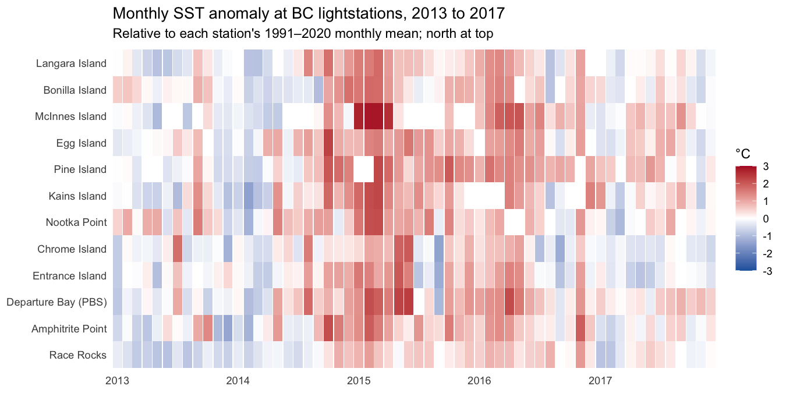

## Why this tutorial

TODO: two or three sentences in your own voice. Suggested angle: you come from epidemiology, where data cleaning, provenance, and governance are routine, and you wanted to learn how the ocean observing community handles the same problems.

## The data

The British Columbia Shore Station Oceanographic Program (BCSOP) has collected daily sea surface temperature and salinity at BC lightstations since 1914. Samples are taken by bucket, near daytime high tide, using the same method for decades so the record stays consistent. CIOOS Pacific serves the data through **ERDDAP**, a data server that turns every request into a URL.

```{r}
#| eval: false
library(rerddap)
info_obj <- info("BCSOP_daily", url = "https://data.cioospacific.ca/erddap/")
raw <- tabledap(info_obj,
                fields = c("profile", "latitude", "longitude", "time", "TEMPTC01"),
                "time>=1991-01-01",
                url = "https://data.cioospacific.ca/erddap/")
```

Things that surprised me as a newcomer:

- The station name is in a variable called `profile`. It carries the CF attribute `cf_role = "timeseries_id"`, which is how software knows it identifies each time series.
- `TEMPTC01` is a code from the BODC parameter vocabulary, which many oceanographic data centres use. The human-readable meaning lives in the `standard_name` attribute: `sea_water_temperature`.
- TODO: add one more of your own.

## Quality control with QARTOD

QARTOD (Quality Assurance of Real-Time Oceanographic Data) is a set of IOOS manuals describing standard tests and a shared flag scheme:

| Flag | Meaning |
|---|---|
| 1 | PASS |
| 2 | NOT_EVALUATED |
| 3 | SUSPECT |
| 4 | FAIL |
| 9 | MISSING |

A key principle: **flags annotate data, they never change it.** Users decide what to exclude.

I implemented four tests in base R (`R/qartod.R`) with unit tests (`tests/test_qartod.R`).

```{r}
#| file: R/qartod.R
#| eval: false
```

### Adapting tests written for real-time sensors

TODO: explain, in your words, why each threshold in `R/config.R` was chosen and what you changed after looking at the plots. Mention the 14-day tidal sampling artifact and how it affects the spike test.

One behaviour worth knowing: a large spike also pulls its neighbours toward SUSPECT, because the test compares each value with the mean of the values either side.

### Results

```{r}
readr::read_csv("data/processed/qc_summary.csv", show_col_types = FALSE) |>
  knitr::kable()
```


TODO: one paragraph on what the flags caught. Did any FAIL values look like real errors (for example a typo like 81.0 for 8.1)?

## Making it analysis-ready: CF and ACDD metadata

- **CF conventions** describe *what the numbers are*: units, standard names, how coordinates and flags link to data.
- **ACDD** describes *the dataset*: title, summary, creator, licence, coverage. These are the attributes catalogues like CIOOS harvest for discovery.

The NetCDF uses the CF "orthogonal multidimensional" layout for time series, where every station shares one time axis. Each flag variable uses a CF standard name such as `spike_test_quality_flag`, and the temperature variable lists them in `ancillary_variables`.

I checked the file with the IOOS Compliance Checker.

TODO: summarise the result honestly, including any ACDD recommendations you did not address.

## The 2014 to 2016 marine heatwave

Anomalies are departures from each station's 1991 to 2020 average for that calendar month. Removing the seasonal cycle this way makes unusual warmth visible. Only PASS and NOT_EVALUATED values are used.




TODO: describe what you see. When did anomalies start and end at these stations? Were northern and southern stations different?

## Connection to salmon

My [BC Salmon Explorer](https://emmabranch.shinyapps.io/bc-salmon-explorer) app shows salmon data for this coast. TODO: one or two careful sentences linking the two, citing a published source you have read on the heatwave and Pacific salmon. Avoid implying this project tests that link; it shows the ocean conditions only.

## Data access and reuse

- Cleaned data and code archived on Zenodo: TODO DOI.
- Source data: BCSOP, Institute of Ocean Sciences, DFO, via CIOOS Pacific, under the Open Government Licence - Canada.

## What I would do next

- Add a climatology test (QARTOD's seasonal range check) using the 1991 to 2020 monthly statistics.
- Compare my flags with the Python `ioos_qc` package on the same data.
- Extend QC to salinity.
