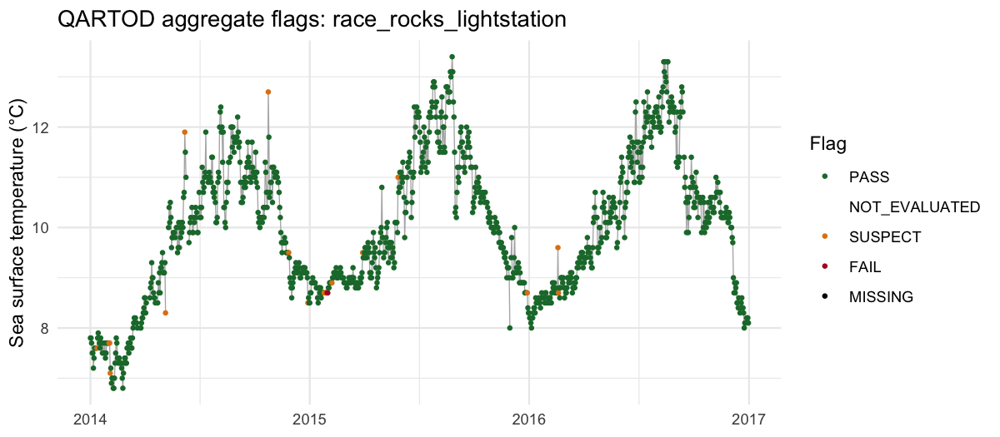

## The QARTOD flag scheme

QARTOD (Quality Assurance of Real-Time Oceanographic Data) is a set of IOOS manuals that describe standard tests and a shared flag scheme:

| Flag | Meaning |
|---|---|
| 1 | PASS |
| 2 | NOT_EVALUATED |
| 3 | SUSPECT |
| 4 | FAIL |
| 9 | MISSING |

A key principle is that **flags annotate data, they never change it**. Users decide what to exclude. I implemented four tests in base R, with unit tests for each.

```{r}
#| file: R/qartod.R
#| eval: false
```

## How I tuned the tests

The QARTOD manuals were written mainly for high-frequency, real-time sensors. These are daily bucket samples, so I treated every threshold as a starting point, looked at what each test flagged, and adjusted where the flags didn't match what a person would question. All settings are in `R/config.R`, and the decisions are logged in the README.

- **Gross range.** I started with a suspect limit of 22 °C. All 47 values above it were at three Strait of Georgia stations (Chrome Island, Departure Bay, and Entrance Island), and they occurred on the same dates across stations in warm summers. A broken thermometer wouldn't do that, so I raised the suspect limit to 26 °C for those stations only.
- **Spike.** Each value is compared with the mean of the days either side. At Departure Bay in July 2024, a value of 8.1 between 18.8 and 17.8 was clearly an error, but it also made its good neighbour fail. I added a rule that a FAIL is downgraded to SUSPECT if a neighbouring value has a larger spike, and wrote a unit test for it.
- **Rate of change.** Flags were spread evenly across stations and months, with no sign of a single faulty record, so I kept the defaults.
- **Flat line.** The longest run was 8.5 °C for about 19 days at Race Rocks in February 2010. I kept the thresholds, but found that some runs reflect a change in recording precision (below).

The data provider notes that sampling near high tide creates a 14-day cycle in daily values. That adds real day-to-day variation, which is one reason the spike and rate of change thresholds are looser than they would be for a continuous sensor.

## What the flags caught

```{r}
test_labels <- c(qc_aggregate = "Aggregate (worst of the four)", qc_gross_range = "Gross range",
                 qc_spike = "Spike", qc_rate_of_change = "Rate of change", qc_flat_line = "Flat line")
readr::read_csv("data/processed/qc_summary.csv", show_col_types = FALSE) |>
  dplyr::mutate(test = factor(test_labels[test], levels = test_labels)) |>
  dplyr::arrange(test) |>
  dplyr::select(Test = test, PASS, SUSPECT, FAIL, NOT_EVALUATED, MISSING) |>
  knitr::kable(format.args = list(big.mark = ","))
```



About 1% of values were flagged: 1,484 SUSPECT and 35 FAIL out of roughly 140,700 observations. Two findings stood out:

- **A value checked against a second variable.** At Nootka Point on 30 March 2022, temperature dropped to 4.6 °C between 9.5 and 11.3. A cold freshwater pulse could in theory cause that, but salinity rose that day rather than falling, so I kept the FAIL.
- **Recording precision varies.** Values are normally recorded to 0.1 °C, so about 10% should be whole numbers by chance. In some station-years it was 30% to 65% (Egg Island 2004 to 2005, Chrome Island 2008 to 2011, Race Rocks 2009, and Nootka Point 1994 to 1995). This suggests periods of whole-degree recording, and it explains several flat-line flags. I didn't alter any values; I documented it as a known issue so users can decide how to treat those periods.
